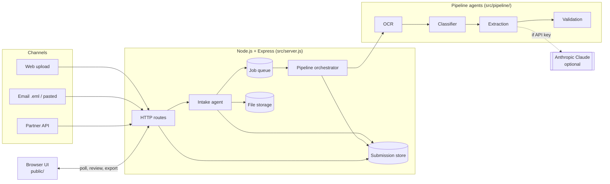
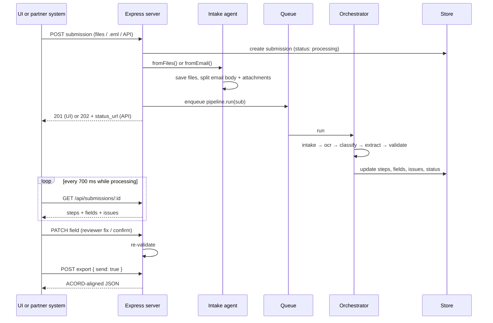
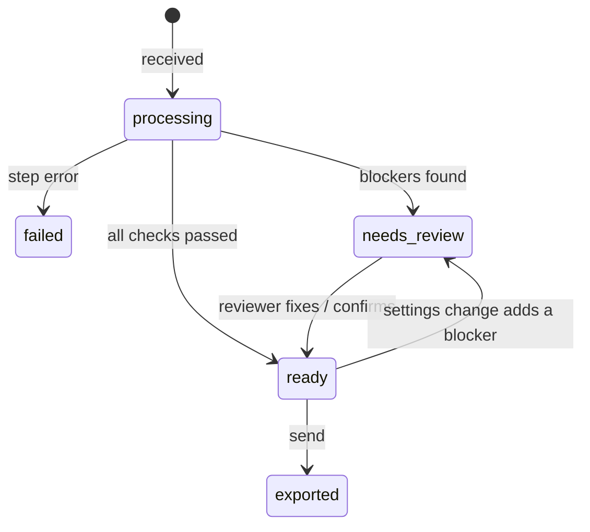

# Submission Intake Bot: Architecture

This document describes how the Submission Intake Bot is built: its components, how a submission flows through the agent pipeline, the data model, and how each part can be swapped for a production service. For setup and the demo, see [README.md](README.md).


## Design principles

1. **AI only where it adds value.** Intake, OCR, classification, validation, and export are deterministic code. The LLM is used for extraction (reading messy, mixed documents) and for polishing the follow-up email. Both have non-AI fallbacks, so the system works with no API key and never stalls on an API failure.
2. **Never guess silently.** Every extracted value carries its source text and a confidence. Low-confidence values go to a person instead of downstream systems.
3. **Explainable output.** Each field shows where it came from; each document shows why it was classified the way it was; each issue says what to fix.
4. **Adapters at every boundary.** OCR engine, file storage, job queue, and submission store are small modules with one interface, so each can be replaced (Textract, S3, BullMQ, Postgres) without touching the pipeline.
5. **Configuration, not code, per client.** Channels, document types, thresholds, required fields, appetite, and destinations are settings.

## System overview



| Layer | Component | File |
|---|---|---|
| Web server | Express app: intake endpoints, review, follow-up, export, settings | `src/server.js` |
| Orchestration | Runs agents in order, tracks step state and timing | `src/pipeline/index.js` |
| Agents | Intake, OCR, Classifier, Extraction, Validation, Follow-up, Export | `src/pipeline/*` |
| Domain model | ACORD 125-aligned field catalog | `src/fields.js` |
| Configuration | Per-client settings with live, beta, and roadmap items | `src/settings.js` |
| Adapters | Store, storage, queue | `src/store.js`, `src/storage.js`, `src/queue.js` |
| Frontend | Single-page app, plain JavaScript, no build step | `public/` |

## Request lifecycle



Requests return immediately after intake; the pipeline runs in the background through the queue. The UI polls the submission every 700 ms while it is processing (to animate the six steps) and refreshes the inbox every 2.5 seconds.

## The pipeline

The orchestrator (`src/pipeline/index.js`) wraps each agent in a `step()` that sets the step to `running`, runs it, records a short detail string and duration, and marks it `done` or `error`. `MIN_STEP_MS` (default 500 ms) keeps each step on screen long enough to follow in a demo. Any thrown error marks the submission `failed` and logs the reason.

### 1. Intake agent (`intake.js`)

Normalizes every channel into one **submission packet**: a list of documents.

- **Upload / API:** each file becomes a document. An API `note` is stored as a `note.txt` text document so it can be read like an email.
- **Email:** parsed with Mailparser. Sender and subject are recorded on the submission; the body becomes an `email-body.txt` document (HTML is stripped if there is no plain-text part); each attachment becomes its own document.
- Files are written through the storage adapter to `uploads/<submission-id>/` with sanitized names.

### 2. OCR agent (`ocr/`)

Picks a reader by document type. Every engine returns the same shape:

```js
{ engine, text, confidence, pageWidth,
  lines: [{ text, words: [{ text, x0, x1, conf }] }] }
```

| Input | Engine | Notes |
|---|---|---|
| Email body, note, `.txt` | `plain-text` | Confidence 100 |
| Digital PDF | `pdf-text` (pdf-parse) | Reads the text layer with positions, groups items into lines by y, splits into words with approximate x. Confidence 100, or 0 with a warning if there is no text layer (a scanned PDF). |
| Image (`png jpg tif bmp webp`) | `tesseract` (Tesseract.js) | Word-level bounding boxes and confidences. A single worker is created lazily and reused. English data ships with `@tesseract.js-data/eng`, so it works offline. |
| `textract`, `azure` | Stubs | Registered so they appear in Settings; throw "not configured" until credentials are added. |

Word positions matter: the offline extractor uses x positions to match values to the labels above them, and word confidences feed hybrid confidence.

### 3. Classifier agent (`classifier.js`)

Rules first, because ACORD forms print their form number and title. Regexes identify ACORD 125, 126, 127, 130, 140, loss runs, and statements of values; email bodies and notes are typed by how they arrived. Each document gets:

- `docType` and `docLabel` (for example `acord_125`, "ACORD 125")
- `reason`, a plain-English explanation shown in the UI
- `supported`, whether that document type is enabled in Settings

Only supported documents go on to extraction. Unsupported ones are kept and reported as info issues.

### 4. Extraction agent (`extraction/`)

Two interchangeable extractors produce the same result: `{ fields, conflicts, summary, engine }`, where each field is `{ value, source, docId, confidence, method }`.

**LLM extractor (`llm.js`)**, used when `ANTHROPIC_API_KEY` is set:

- Sends all supported documents in one request, each wrapped in `<document id type name>` tags.
- Uses **forced tool use** (`tool_choice` = `record_submission`) with a JSON schema whose field keys are an enum of the catalog. The result is always structured, and keys are always valid.
- The system prompt tells the model to extract only literal values (no inference), explains the OCR layout (labels on one line, values below), how checked boxes look after OCR (`X`, `[X]`, `XI`), and the output formats.
- Returns per-field source text and confidence, a list of **conflicts** between documents (for example email says 8 part-time staff, form says 6), and a one-sentence underwriting **summary**.
- Model is set by `ANTHROPIC_MODEL` (default `claude-sonnet-5`).

**Offline layout extractor (`layout.js`)**, used with no key or when the LLM call fails:

- Finds **label lines** by matching each field's printed `formLabel` (longest labels first). A line counts as a label line when at least 60% of its words are label words.
- Reads the **next line** as the values, and assigns words to labels by **column position**: a word belongs to the label whose x range it starts in (with a small tolerance).
- For checkbox fields, finds each option on the value line and treats it as selected when an `X` appears between it and the previous option.
- For email bodies, light rules pick up effective date, lines of business, and years in business. Form values win; email values only fill gaps.

**Hybrid confidence** (`extraction/index.js`), applied after either extractor: for scanned documents, each value is tokenized and matched back to the OCR words it came from. The lowest matching word confidence becomes the field's `ocrConfidence`. If it is below the review threshold, the field is marked low confidence, even if the LLM was sure. This catches cases where the model reads a plausible value from a smudged scan.

If the LLM fails, the reason is stored as `extraction.fallbackReason` and shown in the UI.

### 5. Validation agent (`validation.js`)

Plain rules, no AI. For every field in the catalog:

1. **Missing:** empty and required → `missing` (error). Empty and optional → `empty`.
2. **Normalize and check format** by field type: state, ZIP, FEIN (`12-3456789`), phone (`(503) 555-0100`), email, int, money (`$1,450,000`; understands `K`, `M`, `MM`), NAICS, date (`MM/DD/YYYY`; effective date can't be past), choice, and multi-choice. A failure → `invalid` (error).
3. **Status:** reviewer-confirmed → `verified`; conflicting → `review`; OCR confidence below threshold → `review`; extractor said low → `review`; otherwise `ok`.

Then cross-field and submission-level checks:

- Expiration date must be after the effective date.
- **Appetite** (when enabled): mailing state not in the carrier's states adds a warning. It is advisory and doesn't block sending.
- Unsupported documents and OCR warnings add info issues.

**Readiness** is the percentage of required fields that are `ok` or `verified`. **Blockers** are errors plus fields in `review`. The submission becomes `needs_review` if there are any blockers, otherwise `ready`.

Validation re-runs whenever a reviewer edits a field and whenever Settings change (`revalidateAll()`), so changing the threshold or required fields updates every submission immediately.

### 6. Human review, follow-up, and export

- **Review** (`PATCH /api/submissions/:id/fields/:key`): a reviewer edits or confirms a value. It becomes `verified` with method `reviewer`, any conflict on it is cleared, the action is logged, and the submission is re-validated.
- **Follow-up agent** (`followup.js`): builds a list of missing fields, invalid fields, and conflicts, and fills an email template addressed to the agency (first name taken from the producer). With an API key, the LLM rewrites the body to be warmer while keeping every item, with a 12-second timeout that falls back to the template.
- **Export agent** (`exporter.js`): maps each field to its ACORD path from the catalog (for example `Applicant.MailingAddress.PostalCode`) into a nested JSON object. Multi-choice fields become arrays. It adds submission metadata, the documents with their OCR engine and confidence, and a review block (readiness, fields verified by a reviewer, open issues). Sending is refused with `409` unless the submission is `ready`.

## Data model

### Submission (`store.js`)

```js
{
  id, ref,                 // UUID and human reference (SUB-1041, ...)
  channel,                 // 'upload' | 'email' | 'api'
  from, subject, note, receivedAt,
  status,                  // see lifecycle below
  steps: { intake, ocr, classify, extract, validate, export }, // { state, detail, ms }
  documents: [{
    id, name, mime, size, kind, path,
    ocr: { engine, text, confidence, lines, pageWidth, warning },
    docType, docLabel, reason, supported, supportStatus
  }],
  fields: { [key]: { value, source, docId, confidence, ocrConfidence, method, status, message } },
  conflicts: [{ key, note }],
  issues: [{ key, severity, message }], // severity: 'error' | 'warning' | 'info'
  readiness,               // 0-100
  summary,                 // one-line risk summary (LLM mode)
  extraction: { engine, fallbackReason },
  followup, exported,
  history: [{ at, message }]  // audit log
}
```

### Field catalog (`fields.js`)

Each of the 30 fields defines `key`, `label`, `section`, the printed `formLabel` (used by the layout extractor), `type` (drives validation), `required`, `options` for choices, and the `acord` path (drives export). Adding a field means adding one line here; the LLM schema, layout reader, validation, UI, and export all pick it up.

### Status lifecycle



Field statuses: `ok`, `verified`, `review`, `invalid`, `missing`, `empty`.

## HTTP API

### Web UI endpoints

| Method | Path | Purpose |
|---|---|---|
| `POST` | `/api/submissions` | Upload files (multipart `files`, optional `note`) |
| `POST` | `/api/submissions/email` | Email intake (multipart `eml` file or `raw` text) |
| `POST` | `/api/samples/:name` | Run a bundled sample: `email-scan`, `upload-pdf`, `api-pdf` |
| `GET` | `/api/submissions` | Inbox list |
| `GET` | `/api/submissions/:id` | Full submission (OCR word lists trimmed to low-confidence words) |
| `GET` | `/api/submissions/:id/documents/:docId/file` | Original document |
| `PATCH` | `/api/submissions/:id/fields/:key` | Reviewer edit or confirm (`{ value }`) |
| `POST` | `/api/submissions/:id/followup` | Draft the follow-up email |
| `POST` | `/api/submissions/:id/export` | Preview payload, or send with `{ send: true }` |
| `GET` | `/api/meta` | Field catalog, sections, whether the LLM is on |
| `GET` / `PUT` | `/api/settings` | Read or update settings (re-validates all submissions) |

### Partner API (requires `x-api-key`)

| Method | Path | Response |
|---|---|---|
| `POST` | `/api/v1/submissions` | `202 { id, reference, status, status_url }`. Multipart `files`, optional `source`, `subject`, `note`. |
| `GET` | `/api/v1/submissions/:id` | `{ id, reference, status, readiness, issues }` |

Each channel can be switched off in Settings; a disabled channel returns `403`. Uploads are limited to 10 files of 20 MB each.

## Configuration model (`settings.js`)

One settings object holds everything a client would tune. Each option has a `status` of `live`, `beta`, or `later` (roadmap). Roadmap items are shown in the UI so clients can see the direction, but `update()` refuses to enable them.

| Setting | Options |
|---|---|
| Role | Carrier, Agency, Broker, Technology partner (changes UI wording and the send action) |
| Intake channels | Upload, Email, API (live); Shared inbox, Agency portal, Slack or Teams (later) |
| Supported documents | ACORD 125, Email (live); Loss run (beta); ACORD 126, 127, 130, 140, SOV (later) |
| OCR engine | Tesseract (live); AWS Textract, Azure Document Intelligence (later) |
| Review threshold | 0 to 100, default 70 |
| Required fields | Any subset of the catalog |
| Appetite | On or off, list of states (beta) |
| Output destination | ACORD-aligned JSON (live); Applied Epic, AMS360, HawkSoft, ACORD XML (later) |
| Routing rules | Later |

## Frontend (`public/`)

A single page in plain HTML, CSS, and JavaScript with no build step, served by Express along with locally hosted IBM Plex fonts.

- **New submission** panel with Upload, Email, and API tabs (the API tab shows a ready-to-run curl command and can send a test request).
- **Inbox** of submissions with status, readiness, and issue count.
- **Pipeline** strip showing the six steps live.
- **Documents** panel: the original file, and a "Text read" view that highlights low-confidence OCR words.
- **Submission record**: fields by section with status colors, source text, inline edit and Confirm, and the issues list.
- **Actions**: draft follow-up email (copy or open in mail client), view the JSON payload, send.
- **Settings** panel and the "Viewing as" role switch.

## Scaling path

| Concern | Demo | Production swap | Where |
|---|---|---|---|
| OCR | Tesseract.js, one worker | AWS Textract or Azure Document Intelligence (form-aware, reads checkboxes and key-value pairs) | Add an adapter in `ocr/index.js` returning the same shape |
| Scanned PDFs | Not rasterized | Rasterize pages, then OCR | `ocr/index.js` |
| File storage | Local `uploads/` | S3 or Azure Blob | `storage.js` |
| Queue | In-memory, sequential | Redis + BullMQ with parallel workers | `queue.js` |
| Store | In-memory `Map` | Postgres (or Mongo) | `store.js` |
| Settings | One global object | Per-tenant settings in the database | `settings.js` |
| Intake | Upload, email file, API | Shared mailbox watcher (Graph / Gmail API), agency portal, Slack or Teams | New intake functions in `intake.js` |
| Output | JSON payload | AMS connectors (Applied Epic, AMS360, HawkSoft), ACORD XML, webhooks | `exporter.js` |
| Forms | ACORD 125 | ACORD 126, 127, 130, 140, SOV, loss run parsing | `fields.js`, classifier already recognizes them |

Because every adapter keeps its interface, the pipeline and UI don't change when any of these are swapped. The phased product roadmap is in the README's [Future scope](README.md#future-scope) section.

## Security notes

This is a demo build. Before production:

- Replace the fixed `demo-key` with per-partner API keys stored securely, and add authentication and roles to the web UI.
- Move submissions, settings, and the audit history to a database; files to encrypted object storage with retention rules (submissions contain FEINs and contact details).
- Keep `ANTHROPIC_API_KEY` in a secrets manager. `.env` is git-ignored.
- Add malware scanning and stricter type checks on uploads.

## Error handling and fallbacks

| Failure | Behavior |
|---|---|
| No API key | Offline layout extractor; follow-up uses the template |
| LLM error or bad response | Falls back to layout extractor; reason shown in the UI |
| Follow-up LLM slow | 12-second timeout, template used |
| Scanned PDF with no text layer | Info issue asking for an image upload |
| Unknown file type | Info issue, document kept but not extracted |
| Unsupported document type | Info issue; other documents still processed |
| Any step throws | Step marked `error`, submission `failed`, reason logged |
| Job error | Logged; the queue moves on to the next submission |
