# Submission Intake Bot

Turns messy commercial insurance submissions (scanned ACORD forms, PDFs, and agent emails) into clean, validated, ACORD-aligned records, and flags what a person needs to check before anything reaches underwriting.

Built for the BionicAgent Distribution Lab, tool #5.

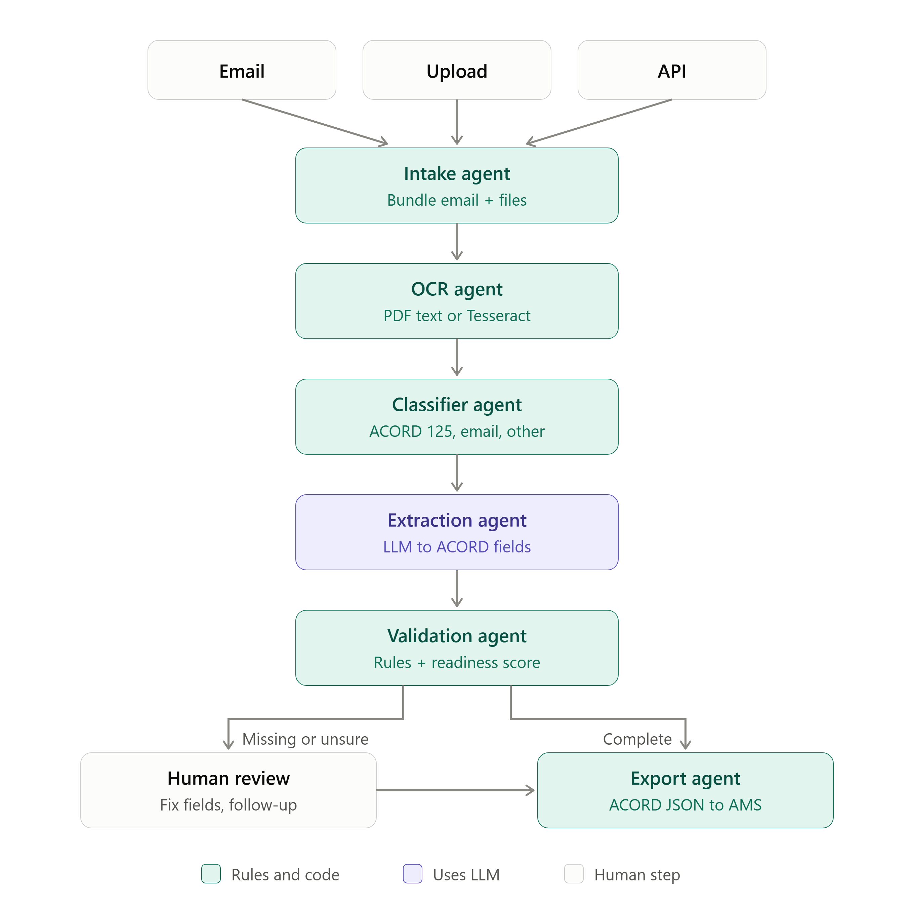

## The problem

Carriers, agencies, and brokers receive hundreds of new-business submissions a week as scanned ACORD forms, PDFs, and free-text emails. Someone retypes each one into an agency management system (AMS) before an underwriter can look at it. That retyping is slow, error-prone, and silent about what is missing.

## What it does

- **Takes submissions from any channel:** file upload, forwarded email (`.eml` or pasted text), or a REST API for partner systems.
- **Reads every document:** Tesseract OCR for scans and images, the embedded text layer for digital PDFs.
- **Identifies each document:** ACORD 125, 126, 127, 130, 140, loss runs, statements of values, and email bodies.
- **Extracts 30 ACORD 125-aligned fields**, with the exact text each value came from. Uses Claude when an API key is set, and an offline layout reader when it isn't.
- **Checks everything:** formats, required fields, date logic, conflicts between documents, and carrier appetite.
- **Knows when it isn't sure:** every value is matched back to the OCR word confidences, and anything below the review threshold goes to a person instead of being trusted.
- **Closes the loop:** drafts a follow-up email to the agent for missing items, lets a reviewer fix or confirm fields, and exports an ACORD-aligned JSON payload.
- **Serves all four sides of distribution:** one engine with Carrier, Agency, Broker, and Technology partner views.

For the full technical design, see [ARCHITECTURE.md](ARCHITECTURE.md).

## Demo

### 1. Intake Dashboard

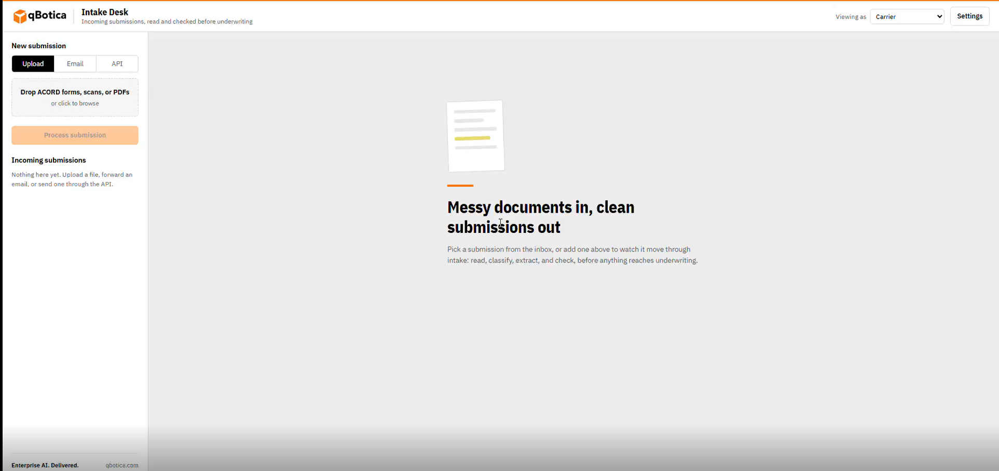

### 2. Document Upload

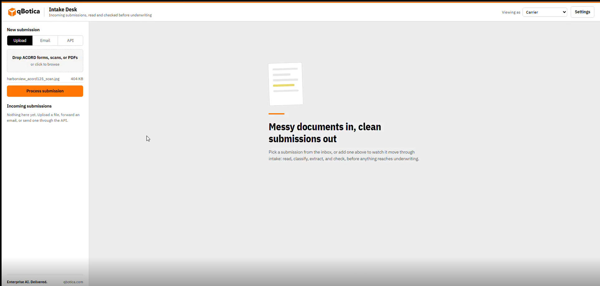

### 3. OCR Processing

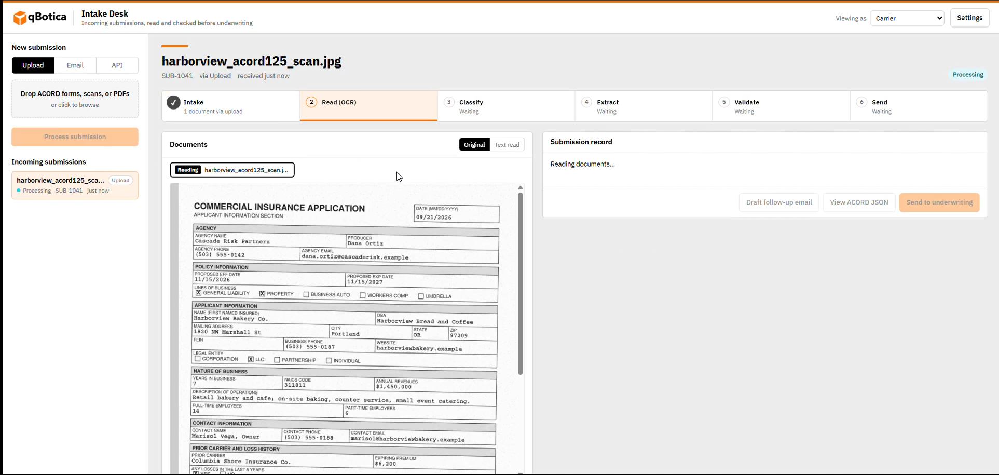

### 4. Document Classification

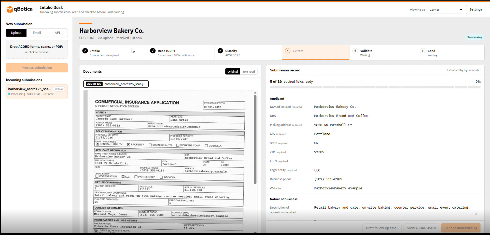

### 5. Field Extraction

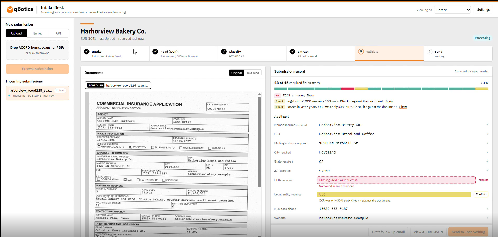

### 6. Validation

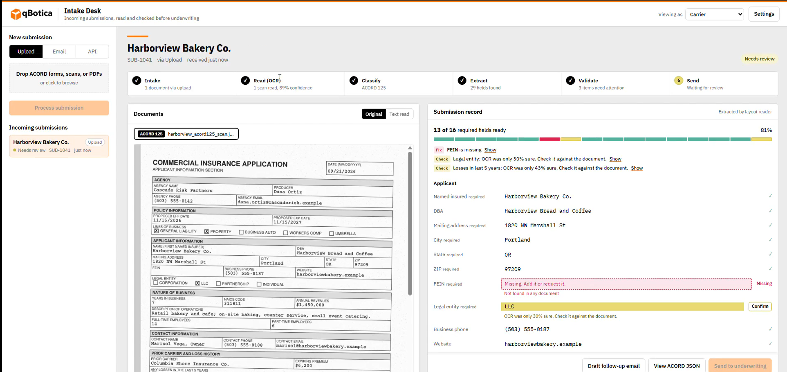

### 7. Missing Field Review

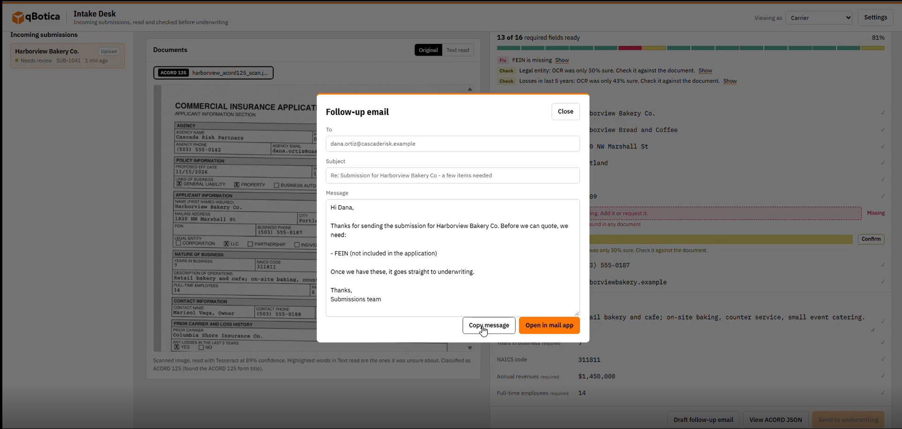

### 8. Enter Missing Information

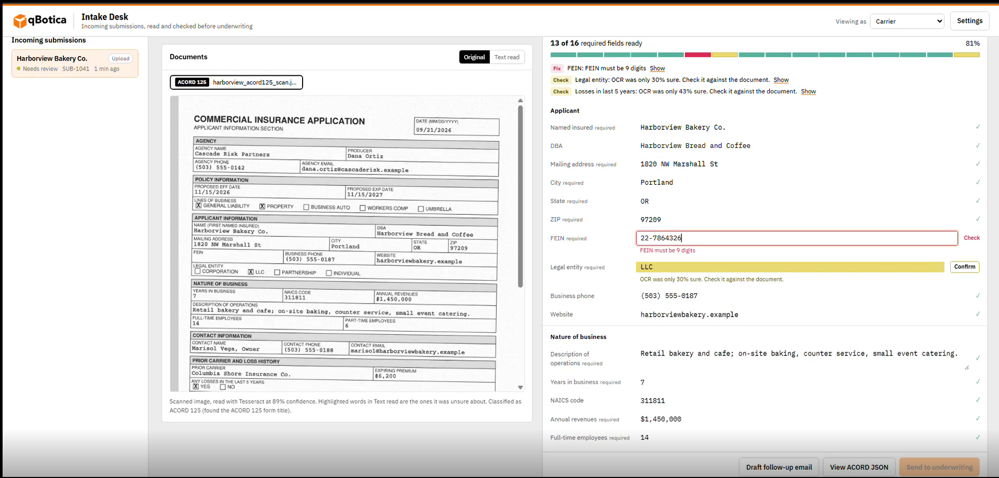

### 9. Confirm Information

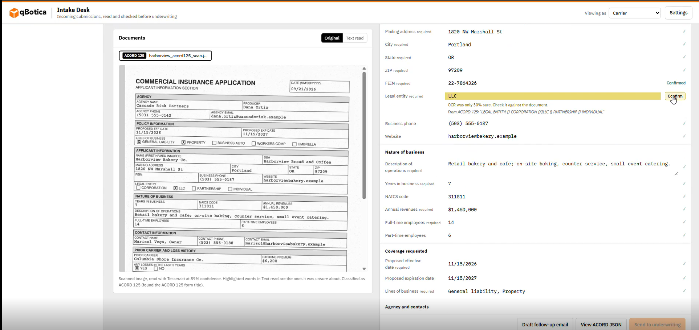

### 10. Send to Underwriting

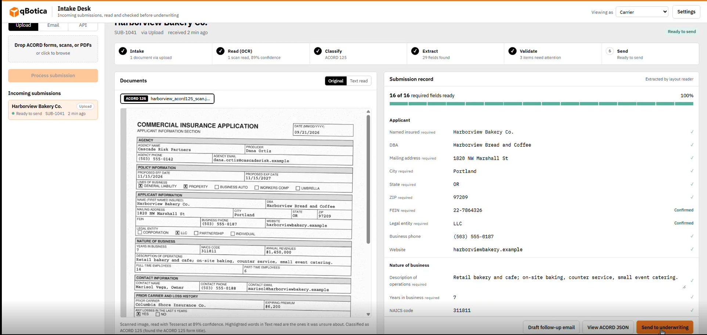

### 11. Final Result

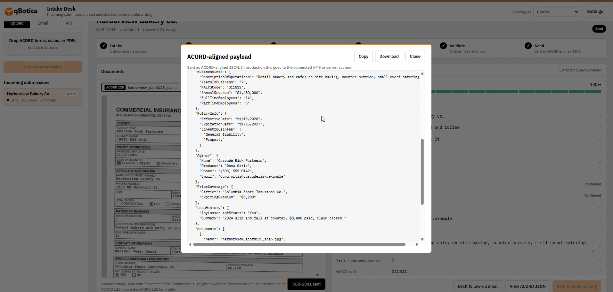


## Run it

```bash
npm install
npm start
# open http://localhost:3000
```

Requires Node 18 or newer. OCR language data ships with the npm install, so it works without internet after that.

**Optional LLM extraction:** copy `.env.example` to `.env` and add an `ANTHROPIC_API_KEY`. Without a key, a built-in layout reader extracts fields from the form structure, so the demo never depends on an API call. If the LLM call fails, it falls back automatically.

### Configuration

All optional, set in `.env`:

| Variable | Default | What it does |
|---|---|---|
| `ANTHROPIC_API_KEY` | (empty) | Turns on LLM extraction and LLM-polished follow-up emails |
| `ANTHROPIC_MODEL` | `claude-sonnet-5` | Model used for extraction and follow-ups |
| `PORT` | `3000` | HTTP port |
| `MIN_STEP_MS` | `500` | Minimum time each pipeline step stays on screen, so viewers can follow the animation. Set to `0` for full speed. |

### Scripts

| Command | What it does |
|---|---|
| `npm start` | Start the server |
| `npm run dev` | Start with auto-restart on file changes (`node --watch`) |
| `npm run samples` | Regenerate the sample documents (needs Python 3 with `reportlab` and `Pillow`) |

## The agents

| Step | Agent | File | Uses AI? |
|---|---|---|---|
| 1 | Intake: bundles email body + attachments from any channel | `src/pipeline/intake.js` | No |
| 2 | OCR: Tesseract for scans, text layer for digital PDFs | `src/pipeline/ocr/` | No |
| 3 | Classifier: identifies ACORD 125, loss runs, emails | `src/pipeline/classifier.js` | No |
| 4 | Extraction: fields plus the text each came from | `src/pipeline/extraction/` | LLM if key set |
| 5 | Validation: formats, required fields, conflicts, appetite | `src/pipeline/validation.js` | No |
| 6 | Human review, follow-up email, export | `followup.js`, `exporter.js` | Follow-up only |

An orchestrator (`src/pipeline/index.js`) runs the agents in order and records each step's state so the UI can animate progress.

**Hybrid confidence:** every extracted value is matched back to the OCR word confidences. Anything read below the review threshold (Settings, default 70%) goes to a person instead of being trusted.

**AI only where it helps:** OCR, classification, validation, and export are plain rules and code, so they are fast, cheap, and explainable. The LLM is used only for extraction and for polishing the follow-up email, and both have non-AI fallbacks.

## What gets extracted

30 fields modeled on ACORD 125, in five sections. Required fields (marked *) count toward the readiness score; you can change which are required in Settings.

| Section | Fields |
|---|---|
| Applicant | Named insured*, DBA, Mailing address*, City*, State*, ZIP*, FEIN*, Legal entity*, Business phone, Website |
| Nature of business | Description of operations*, Years in business*, NAICS code, Annual revenues*, Full-time employees*, Part-time employees |
| Coverage requested | Proposed effective date*, Proposed expiration date, Lines of business* |
| Agency and contacts | Agency*, Producer, Agency phone, Agency email, Applicant contact*, Contact phone, Contact email |
| Prior carrier and losses | Prior carrier, Expiring premium, Losses in last 5 years*, Loss summary |

The field catalog, including each field's ACORD path, lives in `src/fields.js`.

## Validation rules

- **Formats:** 2-letter US state, 5 or 9 digit ZIP, 9 digit FEIN (formatted `12-3456789`), 10 digit phone, email, whole numbers, dollar amounts (`1.2M` and `450K` are understood), 2 to 6 digit NAICS, dates as `MM/DD/YYYY`.
- **Choices:** legal entity, losses yes or no, and lines of business must match the allowed options.
- **Date logic:** effective date can't be in the past; expiration must be after effective.
- **Required fields:** anything missing is flagged and added to the follow-up email.
- **Conflicts:** if the email and the form disagree (LLM mode), the field goes to review with the reason.
- **Uncertainty:** low OCR confidence or a low-confidence extraction sends the field to review.
- **Appetite (optional):** flags submissions outside the states the carrier writes in.

Each submission gets a **readiness score** (the share of required fields that are valid or confirmed) and a status: `processing`, `needs_review`, `ready`, `exported`, or `failed`. A submission can't be sent until every blocking item is resolved.

## Intake channels

- **Upload:** drag and drop PDFs or images (up to 10 files, 20 MB each).
- **Email:** drop a forwarded `.eml` file (attachments are pulled out) or paste the text.
- **API:** `POST /api/v1/submissions` with header `x-api-key: demo-key`. See `samples/api_example.sh`.

### Partner API

```bash
# Submit (returns 202 with an id and a status_url)
curl -X POST http://localhost:3000/api/v1/submissions \
  -H "x-api-key: demo-key" \
  -F "source=Partner portal" \
  -F "subject=Summit Ridge Roofing LLC" \
  -F "note=Roofing contractor, GL only." \
  -F "files=@samples/summit_ridge_acord125.pdf"

# Check status
curl -H "x-api-key: demo-key" http://localhost:3000/api/v1/submissions/<id>
# -> { id, reference, status, readiness, issues: [...] }
```

The full list of endpoints the UI uses is in [ARCHITECTURE.md](ARCHITECTURE.md#http-api).

## Output

Clicking send produces an ACORD-aligned JSON payload, the shape an AMS like Applied Epic would receive (abbreviated example):

```json
{
  "standard": "ACORD 125 aligned (demo schema)",
  "destination": "ACORD-aligned JSON",
  "submission": { "reference": "SUB-1041", "receivedVia": "email", "from": "...", "subject": "..." },
  "Applicant": { "NamedInsured": "...", "FEIN": "12-3456789", "MailingAddress": { "Street": "...", "City": "...", "State": "OR", "PostalCode": "97201" } },
  "BusinessInfo": { "DescriptionOfOperations": "...", "AnnualRevenue": "$1,450,000" },
  "PolicyInfo": { "EffectiveDate": "01/01/2027", "LinesOfBusiness": ["General liability", "Property"] },
  "Agency": { "Name": "...", "Producer": "..." },
  "LossHistory": { "AnyLossesLast5Years": "No" },
  "documents": [{ "name": "harborview_acord125_scan.jpg", "type": "ACORD 125", "ocrEngine": "tesseract", "ocrConfidence": 81 }],
  "review": { "readiness": 100, "verifiedByReviewer": ["fein"], "openIssues": [] }
}
```

## Settings and customization

Everything a client would tune is in the Settings panel (backed by `src/settings.js`). Items are marked **Live**, **Beta**, or **Roadmap**.

- **Intake channels:** Upload, Email, API (live). Shared inbox, agency portal, Slack or Teams (roadmap).
- **Document types:** ACORD 125 and email body (live), loss runs (beta). ACORD 126, 127, 130, 140, and SOV are recognized by the classifier but not yet extracted (roadmap).
- **OCR engine:** Tesseract (live). AWS Textract and Azure Document Intelligence (roadmap).
- **Review threshold:** the OCR confidence below which a field goes to a person.
- **Required fields:** choose which fields block a submission.
- **Appetite check:** list the states you write in (beta, default OR, WA, ID, CA).
- **Output destination:** ACORD-aligned JSON (live). Applied Epic, AMS360, HawkSoft, ACORD XML (roadmap).
- **Routing rules:** for example, Oregon and Washington to the Pacific Northwest desk (roadmap).

### Roles

The "Viewing as" switch changes the wording and actions for each side of distribution, on the same engine:

| Role | Inbox | Send action |
|---|---|---|
| Carrier | Incoming submissions | Send to underwriting |
| Agency | Client submissions | Send to carrier |
| Broker | Submissions to market | Send to markets |
| Technology partner | API and partner activity | Send by webhook |

## Swappable parts (for the "scales later" slide)

- **OCR engine:** `src/pipeline/ocr/index.js`. Add AWS Textract or Azure Document Intelligence as another adapter returning the same shape.
- **Storage:** `src/storage.js`. Local folder now; S3 or Azure Blob later.
- **Queue:** `src/queue.js`. In-memory now; Redis + BullMQ later for parallel processing.
- **Store:** `src/store.js`. In-memory now; Postgres later.

## Project structure

```
submission-intake-bot/
├── README.md               This file
├── ARCHITECTURE.md         Full technical design
├── architecture.png        Agent pipeline diagram
├── .env.example            Optional settings (API key, model, port)
├── package.json
├── src/
│   ├── server.js           Express server: intake channels, review, export, settings API
│   ├── fields.js           ACORD 125-aligned field catalog
│   ├── settings.js         Per-client configuration (channels, documents, thresholds, appetite)
│   ├── store.js            Submission store (in-memory)
│   ├── storage.js          File storage (local uploads/ folder)
│   ├── queue.js            Job queue (in-memory, sequential)
│   └── pipeline/
│       ├── index.js        Orchestrator: runs the agents in order
│       ├── intake.js       Intake agent
│       ├── ocr/            OCR agent: Tesseract and PDF text layer adapters
│       ├── classifier.js   Classifier agent
│       ├── extraction/     Extraction agent: LLM (llm.js) and offline layout reader (layout.js)
│       ├── validation.js   Validation agent
│       ├── followup.js     Follow-up email agent
│       └── exporter.js     Export agent
├── public/                 Frontend (plain HTML, CSS, JavaScript; no build step)
│   └── brand/              qBotica logo
├── samples/                Fictional demo submissions
└── tools/make_samples.py   Generates the samples
```

## Tech stack

- **Backend:** Node.js 18+, Express 5, Multer (uploads), Mailparser (`.eml`), pdf-parse (PDF text layer), Tesseract.js (OCR)
- **AI:** Anthropic Claude via `@anthropic-ai/sdk`, using forced tool use for structured extraction
- **Frontend:** plain HTML, CSS, and JavaScript; IBM Plex fonts served locally
- **Samples:** Python with reportlab and Pillow

## Branding

Styled to the qBotica Brand Guidelines 2026-2027:

- **Colors:** Orange `#FF7705` for actions and accents, Black and Dark Grey `#636466` for text and structure. The secondary palette carries status: Pastel Yellow for "needs review" highlights, Turquoise Green for ready, Pastel Red for missing, Turquoise Blue for processing.
- **Type:** IBM Plex Sans (the approved digital typeface), with Plex Sans Condensed for headlines and Plex Mono for extracted values. Fonts are served locally, so they work offline.
- **Logo:** the official logo is in `public/brand/qbotica-logo.png` (an `.svg` there takes priority if added). If no logo file is present, the header shows the name as text. The logo is never redrawn, per the guidelines.
- Buttons use black text on orange, because white on `#FF7705` is too low-contrast to read comfortably.

## Demo script (about 2 minutes)

1. **The problem.** "Carriers get hundreds of submissions a week as scanned forms and emails. Someone retypes each one before an underwriter can even look at it."
2. **Scanned form by email.** Drag `samples/harborview_submission.eml` into the Email tab and click Process email. Watch the six steps run. Point out it pulled the scan out of the email and read it with OCR.
3. **Text read tab.** Show the highlighted words. "OCR tells us exactly what it wasn't sure about."
4. **Review.** "FEIN is missing, and two checkboxes were read at 30 to 43% confidence, so instead of guessing, it asks a person." Click Draft follow-up email to show the ready-to-send request to the agent.
5. **Fix and send.** Type a FEIN, click Confirm on the two highlighted fields, and send. Show the ACORD-aligned JSON: "This is what an AMS like Applied Epic would receive."
6. **Other channels.** Drag `samples/pinecrest_acord125.pdf` into the Upload tab and click Process submission (complete, straight to Ready). Then open the API tab and click Send a test request.
7. **Customization.** Open Settings. Turn on the appetite check (Texas roofing gets flagged instantly), drag the review threshold, and point out the roadmap items: shared inbox, more ACORD forms, Textract, AMS destinations, routing.
8. **Roles.** Switch "Viewing as" between Carrier, Agency, Broker, and Technology partner: one engine, different views for all four sides of distribution.

## Samples

All in `samples/`, all fictional. Regenerate with `npm run samples` (needs Python with reportlab and Pillow).

- `harborview_submission.eml`: agent email with a scanned ACORD 125-style form attached, missing FEIN, and an email that says 8 part-time staff while the form says 6 (flagged as a conflict in LLM mode).
- `harborview_acord125_scan.jpg`: the scan on its own.
- `pinecrest_acord125.pdf`: complete digital form.
- `summit_ridge_acord125.pdf`: Texas roofing contractor, for the appetite demo.
- `api_example.sh`: sends a submission through the partner API with curl.

The forms are modeled on ACORD 125 fields for demo purposes and are not official ACORD forms.

## Known limitations

This is a hackathon build. Before production:

- Submissions and settings are kept in memory and reset when the server restarts. Uploaded files are kept in `uploads/`.
- The queue processes one submission at a time.
- Scanned PDFs (no text layer) aren't rasterized for OCR yet. Upload scans as images instead.
- The API key is the fixed demo value `demo-key`, and the web UI has no login.
- Extraction is tuned for ACORD 125; other ACORD forms are recognized but not extracted.
- Conflict detection between the email and the form needs LLM mode; the offline reader fills gaps from the email but doesn't compare.
- OCR is English only.

## Future scope

The code is already built for most of these: the adapters (`ocr/`, `storage.js`, `queue.js`, `store.js`) keep one interface, the classifier already recognizes more ACORD forms, and Settings shows the roadmap items so clients can see where it's going. See the [scaling path](ARCHITECTURE.md#scaling-path) for which file each change touches.

### Phase 1: Production ready

- **Persistence:** Postgres for submissions, settings, and the audit history; S3 or Azure Blob for files, encrypted, with retention rules.
- **Parallel processing:** Redis + BullMQ with multiple OCR and extraction workers.
- **Security:** SSO login and role-based access for the web UI; per-partner API keys with rotation and rate limits; malware scanning on uploads.
- **Scanned PDFs:** rasterize PDF pages without a text layer, then OCR them.
- **Webhooks:** notify partner systems when a submission's status changes, instead of making them poll.
- **Operations:** Docker image, health checks, structured logging, and monitoring.

### Phase 2: Broader coverage

- **More forms:** extract ACORD 126 (general liability), 127 (business auto), 130 (workers comp), and 140 (property), plus statements of values from Excel or CSV.
- **Loss run parsing:** turn loss runs into structured claims (date, type, paid, reserved, open or closed) that fill the loss summary and feed underwriting.
- **Form-aware OCR:** AWS Textract or Azure Document Intelligence for checkboxes, tables, key-value pairs, and handwriting.
- **More intake channels:** a shared mailbox watcher (Microsoft Graph or Gmail API), a branded agency upload portal, and Slack or Teams.
- **More languages:** Spanish and other OCR language packs.

### Phase 3: Workflow and integrations

- **AMS destinations:** push directly to Applied Epic, Vertafore AMS360, and HawkSoft, or export ACORD XML.
- **Routing:** send submissions to the right desk or underwriter by state, line of business, or revenue, with turnaround timers.
- **Richer appetite rules:** class codes and NAICS, revenue bands, lines of business, and loss history, not just state.
- **Clearance:** detect duplicate submissions for the same insured from different agencies.
- **Follow-up loop:** send the follow-up email, read the agent's reply, and fill in the missing fields automatically.
- **Data enrichment:** verify FEINs, standardize addresses, and suggest NAICS codes from the description of operations.

### Phase 4: Intelligence and analytics

- **Learn from reviewers:** use reviewer corrections to improve extraction, including per-agency form templates.
- **Analytics dashboard:** volume by channel, turnaround time, straight-through rate, fields most often fixed, and completeness by agency.
- **Underwriting triage:** rank submissions by fit and completeness so underwriters see the best ones first.
- **Accuracy testing:** a labeled set of submissions that measures field accuracy on every release.
- **Multi-tenant:** per-client settings, branding, field catalogs, and destinations.
